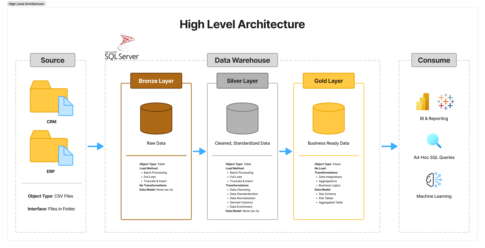

# Data Warehouse Project (SQL Server)

> **📚 Learning project**
> This is a learning project built while following the free *SQL Data Warehouse*
> course by **Baraa Khatib Salkini** ([Data With Baraa](https://github.com/DataWithBaraa/sql-data-warehouse-project)).
>
> - Original repository: https://github.com/DataWithBaraa/sql-data-warehouse-project
> - Video tutorial: https://youtu.be/SSKVgrwhzus?si=jnNL6c97yBya66NP
>
> The original idea, structure and data belong to the author. I followed the course
> step by step to practice SQL and data warehousing. My own changes and additions
> are listed in the section [What I did myself](#what-i-did-myself).

## Overview

Building a modern data warehouse with SQL Server, including ETL processes,
data modeling and analytics.

Raw data from two source systems (CRM and ERP, provided as CSV files) is loaded,
cleaned and combined into a single data model that is ready for analysis.

## Architecture

The project follows the **Medallion Architecture**:


*Diagram redrawn by me in Figma, based on the course.*

| Layer | Purpose |
|--------|---------|
| **Bronze** | Raw data loaded as-is from the CSV files |
| **Silver** | Cleaned and standardized data |
| **Gold** | Business-ready data modeled as a star schema for reporting and analytics |

## Tech Stack

- SQL Server
- SQL Server Management Studio (SSMS)
- Git / GitHub
- Figma (diagrams)

## Repository Structure

```
.
├── datasets/              # source CSV files (CRM and ERP)
├── docs/                  # diagrams, data catalog, naming conventions
├── scripts/
│   ├── init_database.sql  # creates the database and the bronze/silver/gold schemas
│   ├── bronze/            # ddl_bronze.sql, proc_load_bronze.sql
│   ├── silver/            # ddl_silver.sql, proc_load_silver.sql
│   └── gold/              # ddl_gold.sql (views)
├── tests/                 # data quality checks for silver and gold
├── LICENSE
└── README.md
```

## How to Run

1. Install SQL Server and SSMS.
2. Save the `datasets/` folder on your computer and update the six file paths
   in `scripts/bronze/proc_load_bronze.sql`.
3. Run `scripts/init_database.sql` (**warning:** it drops and recreates the `DataWarehouse` database).
4. Run `scripts/bronze/ddl_bronze.sql` and `scripts/bronze/proc_load_bronze.sql`, then `EXEC bronze.load_bronze;`
5. Run `scripts/silver/ddl_silver.sql` and `scripts/silver/proc_load_silver.sql`, then `EXEC silver.load_silver;`
6. Run `scripts/gold/ddl_gold.sql`.
7. Run the checks from the `tests/` folder.

## What I Did Myself
*Will be completed when the project is finished.*

## What I Learned
*Will be completed when the project is finished.*

## License

This project is licensed under the [MIT License](LICENSE).
The original work is Copyright (c) 2024 Baraa Khatib Salkini.

## Next Steps
- Build a dashboard (Power BI or Excel) on top of the Gold layer.
