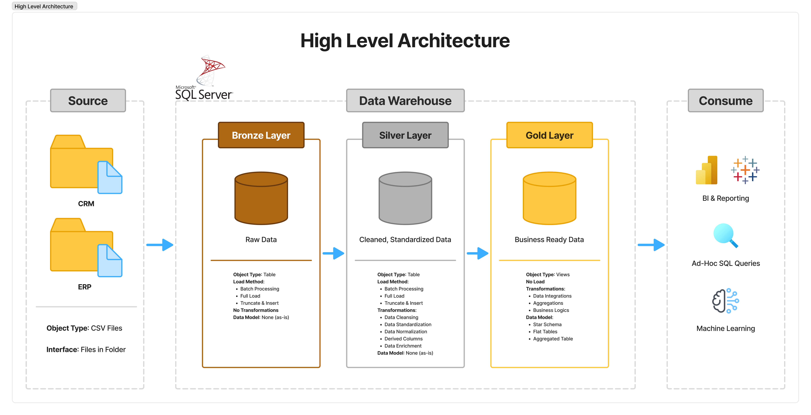

# Data Warehouse Project (SQL Server)

> **📚 Learning project**
> This is a learning project built while following the free *SQL Data Warehouse*
> course by **Baraa Khatib Salkini** ([Data With Baraa](https://github.com/DataWithBaraa/sql-data-warehouse-project)).
>
> - Original repository: https://github.com/DataWithBaraa/sql-data-warehouse-project
> - Video tutorial: https://youtu.be/SSKVgrwhzus?si=jnNL6c97yBya66NP
>
> The original idea, structure and data belong to the author. I followed the course
> step by step to practice SQL and data warehousing. 

## Overview

Building a modern data warehouse with SQL Server, including ETL processes and data modeling.

Raw data from two source systems (CRM and ERP, provided as CSV files) is loaded,
cleaned and combined into a single data model that is ready for analysis.

## Architecture

The project follows the **Medallion Architecture**:



*Diagram redrawn by me in Figma, based on the course.*

| Layer | Purpose |
|--------|---------|
| **Bronze** | Raw data loaded as-is from the CSV files |
| **Silver** | Cleaned and standardized data |
| **Gold** | Business-ready data modeled as a star schema for reporting and analytics |

## Tech Stack

- SQL Server
- SQL Server Management Studio (SSMS)
- Git / GitHub
- Figma (diagrams)

## Repository Structure

```
sql-data-warehouse-project/
├── datasets/              # six source CSV files (CRM and ERP)
│   ├── source_crm/        # three files from the CRM system
│   └── source_erp/        # three files from the ERP system
├── docs/                  # diagrams, data catalog, naming conventions
├── scripts/               # the project scripts
│   ├── init_database.sql  # creates the database and the bronze/silver/gold schemas
│   ├── bronze/            # loads the raw files
│   ├── silver/            # cleans and prepares the data
│   └── gold/              # builds the tables for analysis (views)
├── tests/                 # data quality checks for silver and gold data
├── LICENSE
└── README.md
```

## How to Run

1. Install SQL Server and SSMS.
2. Save the `datasets/` folder on your computer and update the six file paths
   in `scripts/bronze/proc_load_bronze.sql`.
3. Run `scripts/init_database.sql` (**warning:** it drops and recreates the `DataWarehouse` database).
4. Run `scripts/bronze/ddl_bronze.sql` and `scripts/bronze/proc_load_bronze.sql`, then `EXEC bronze.load_bronze;`
5. Run `scripts/silver/ddl_silver.sql` and `scripts/silver/proc_load_silver.sql`, then `EXEC silver.load_silver;`
6. Run `scripts/gold/ddl_gold.sql`.
7. Run the checks from the `tests/` folder.

## What I Learned

This was my first end-to-end data project. By building it I practiced:

- **Data architecture:** designing a Medallion warehouse (Bronze, Silver, Gold) and documenting the data flow.
- **ETL in SQL Server:** loading CSV files with `BULK INSERT` and writing stored procedures to load each layer.
- **Data cleaning:** removing duplicates and extra spaces, standardizing codes (e.g. M/F, country codes), fixing invalid dates and inconsistent sales values.
- **Data modeling:** combining CRM and ERP sources into a star schema with surrogate keys, plus a data catalog.
- **Data quality checks:** writing SQL tests for duplicates, nulls and broken links between facts and dimensions.
- **Working with Git:** organizing a repository, documenting code and committing step by step.

Writing the load stored procedures (`bronze.load_bronze`, `silver.load_silver`) was the most challenging part.
Variables (`DECLARE`) for timing each load and `BEGIN TRY … BEGIN CATCH` for error handling were new to me;
I now understand they make ETL runs easy to monitor and debug, and I plan to keep practicing them on my own examples.

## License

This project is licensed under the [MIT License](LICENSE).
The original work is Copyright (c) 2024 Baraa Khatib Salkini.
